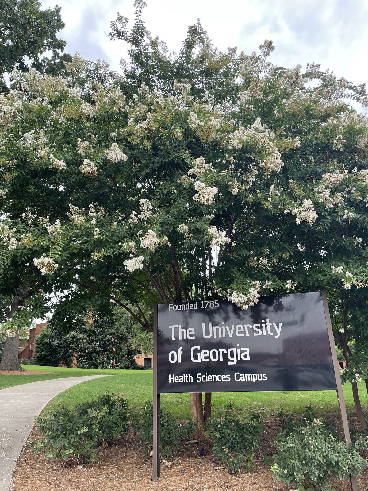
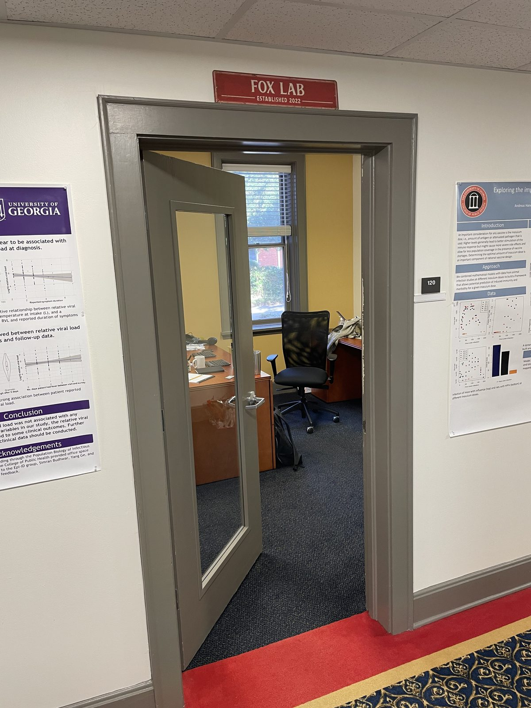
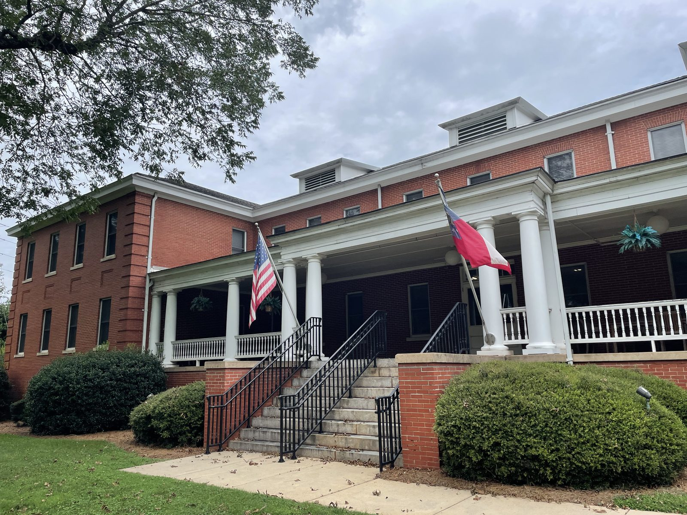
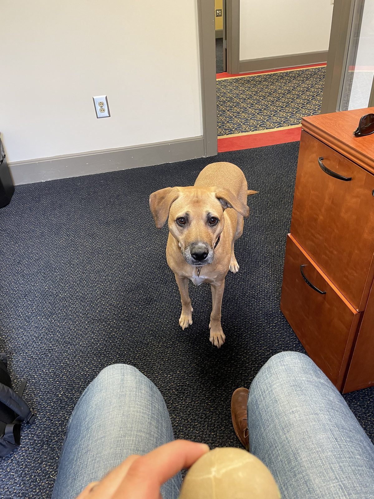

In summer 2022, Spencer accepted a position as an Assistant Professor at the University of Georgia, jointly appointed in the Department of Epidemiology & Biostatistics and the Institute of Bioinformatics.

That move marked the launch of The Fox Lab.

The lab began with strong connections to infectious disease modeling, public health forecasting, and ongoing collaborations with the UT COVID-19 Modeling Consortium.

{fig-alt="Moving across the country to Georgia." loading="lazy" decoding="async"}

{fig-alt="Entrance to the UGA Health Sciences Campus." loading="lazy" decoding="async"}

{fig-alt="New office at UGA." loading="lazy" decoding="async"}

{fig-alt="Miller Hall at UGA." loading="lazy" decoding="async"}

{fig-alt="Office dog visit." loading="lazy" decoding="async"}
