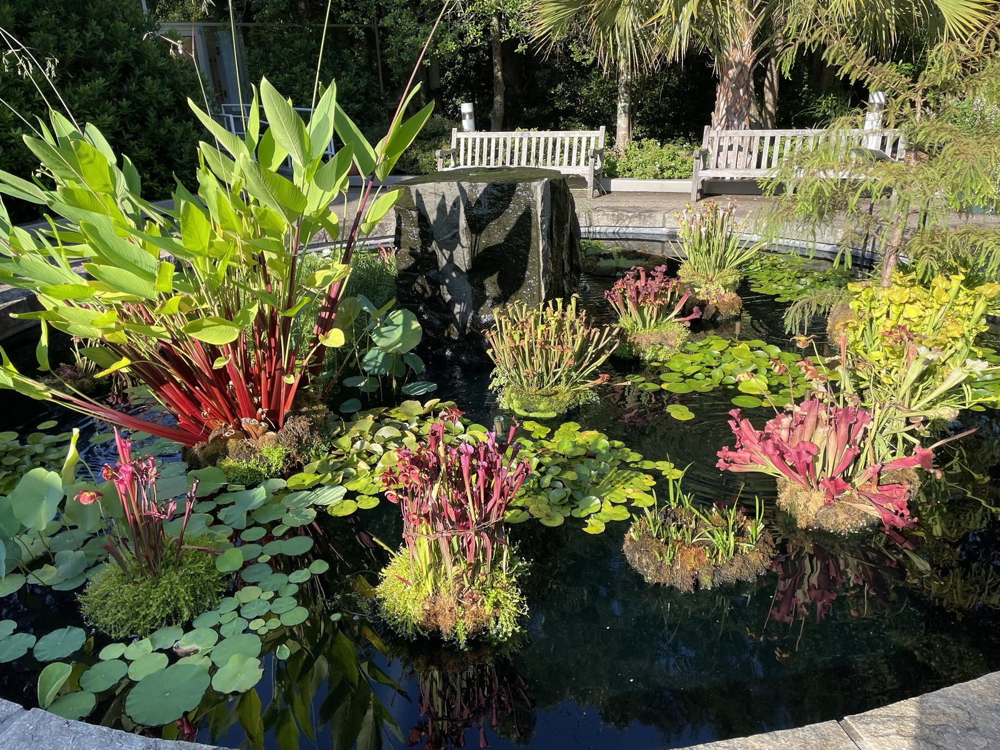

The Fox Lab advertised for a postdoctoral associate in Fall 2024.

The position focused broadly on infectious disease forecasting and modeling, with flexibility for the postdoc to shape projects around their interests and overlap with the lab's work.

The post described a two-year position, support for conference travel and research expenses, and flexibility around work arrangements and start dates.

Current opportunities are maintained on the [Opportunities](../../opportunities.qmd) page.

{fig-alt="State Botanical Garden near the UGA campus." loading="lazy" decoding="async"}
