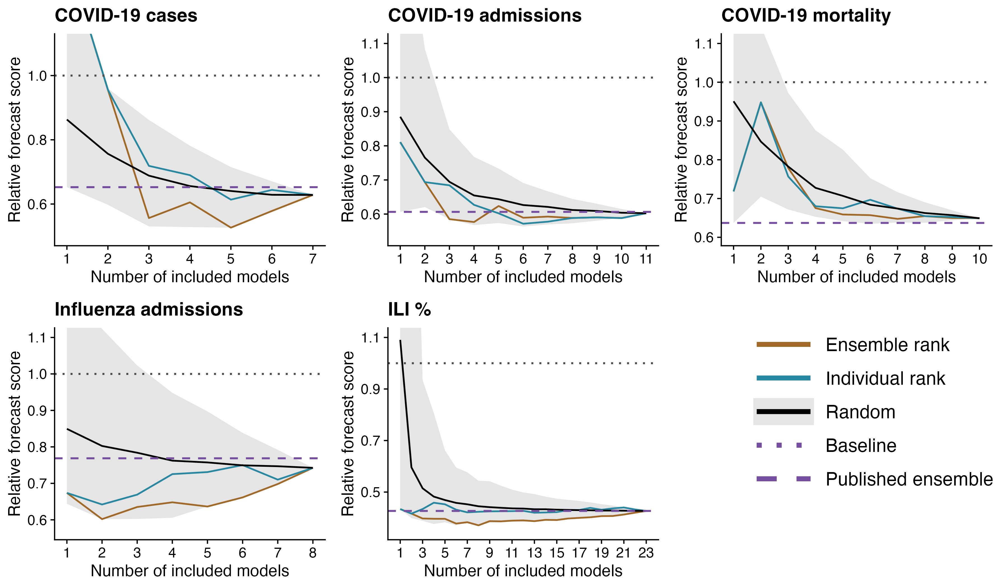

The Fox Lab's first lab-led paper from Spencer's time at UGA was published in *Emerging Infectious Diseases*: [Optimizing Disease Outbreak Forecast Ensembles](https://doi.org/10.3201/eid3009.240026).

The project grew out of conversations at the 2022 CSTE Forecasting Conference. Collaborative forecast hubs often receive many weekly model submissions, but public health communication usually centers on a single ensemble forecast. That raised a practical question: how many models are needed for a robust ensemble?

The team gathered forecasts from recent collaborative hubs, assembled random ensembles of different sizes, and scored their performance.

{fig-alt="Individual and ensemble outbreak forecasts, followed by relative forecast scores for five forecast targets. Average scores and their variability decrease as more models enter an ensemble, with diminishing gains." loading="lazy" decoding="async"}

Three key patterns emerged:

1. Adding models generally improved average forecast performance and reduced variability.
2. Performance gains tended to level off after roughly four or five models.
3. Ensembles needed at least four validated models to reliably beat baseline forecasts.

The analysis also suggested that some smaller ensembles could outperform published all-model ensembles, motivating future work on real-time model selection and weighting.

{fig-alt="Relative forecast scores versus ensemble size for five outbreak targets, comparing ensemble ranking, individual ranking, random selection, baseline forecasts, and published ensembles." loading="lazy" decoding="async"}

The project relied heavily on infrastructure from the [hubverse](https://hubverse.io/) ecosystem. Code for the analysis is available at [github.com/sjfox/ensemble-size](https://github.com/sjfox/ensemble-size).
