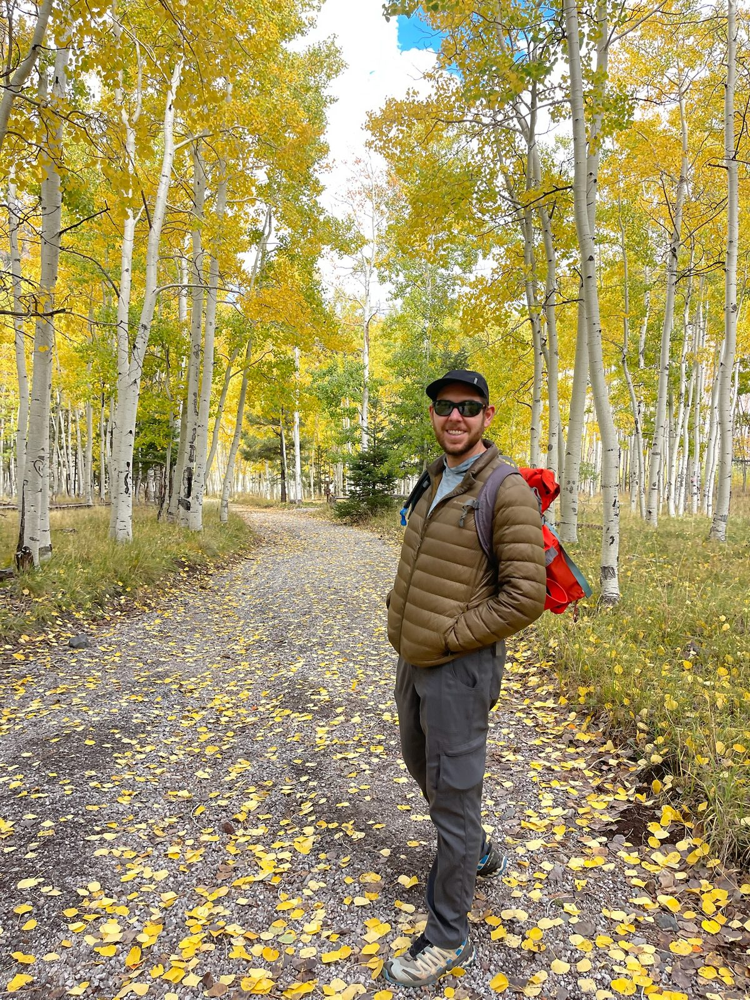
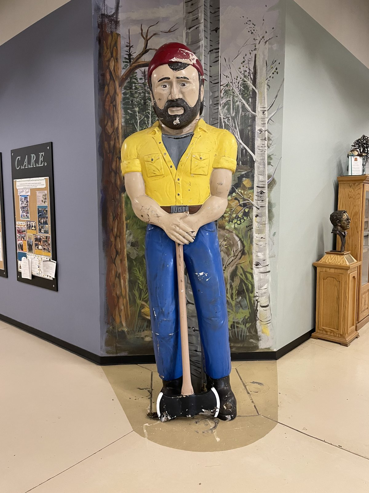
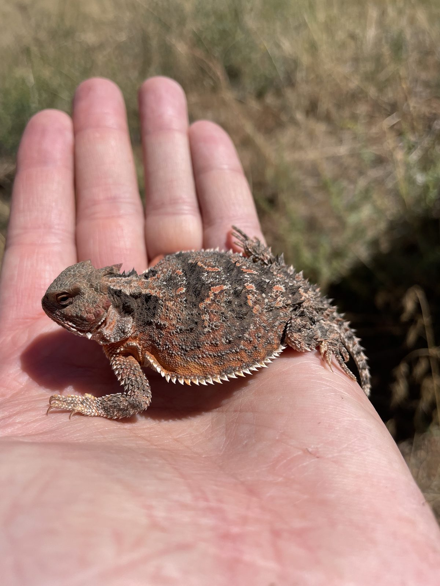
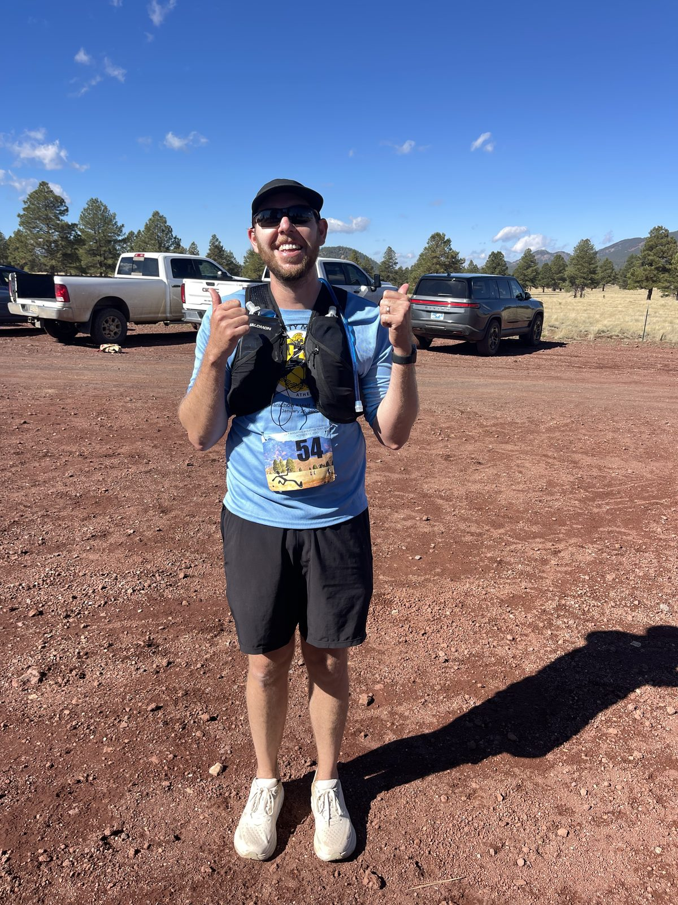

The Fox Lab has moved from the University of Georgia to Northern Arizona University in Flagstaff, Arizona.

Leaving UGA is bittersweet. Athens was home to wonderful colleagues, students, and collaborators. At the same time, the lab is excited to begin a new chapter at NAU, surrounded by an inspiring research community and the landscapes of northern Arizona.

{fig-alt="The Fox Lab's move to Flagstaff." loading="lazy" decoding="async"}

{fig-alt="Northern Arizona landscape." loading="lazy" decoding="async"}

{fig-alt="Flagstaff, Arizona." loading="lazy" decoding="async"}

{fig-alt="A new chapter at NAU." loading="lazy" decoding="async"}

At NAU, the lab is housed in the [School of Informatics, Computing, and Cyber Systems](https://nau.edu/school-of-informatics-computing-and-cyber-systems/) and connected with the [Center for Community Health and Engaged Research](https://legacy.nau.edu/cher/) and the [Pathogen and Microbiome Institute](https://in.nau.edu/pmi/).

The lab's work has leaned deeply into outbreak forecasting over the past several years: behavior-powered forecast models, ensemble forecasting approaches, forecasting hub design, model augmentation, respiratory virus forecasting, and international collaborations in Paraguay and other Southern Hemisphere settings.

The next phase will continue that trajectory while expanding to new diseases, new regions, and the modeling infrastructure needed for the next generation of predictive public health science.

PhD and postdoc positions will be opening soon. Interested students and researchers are welcome to reach out to [spencer.fox@nau.edu](mailto:spencer.fox@nau.edu).

{fig-alt="Thirty kilometers and a major life decision later, still standing in Flagstaff." loading="lazy" decoding="async"}
