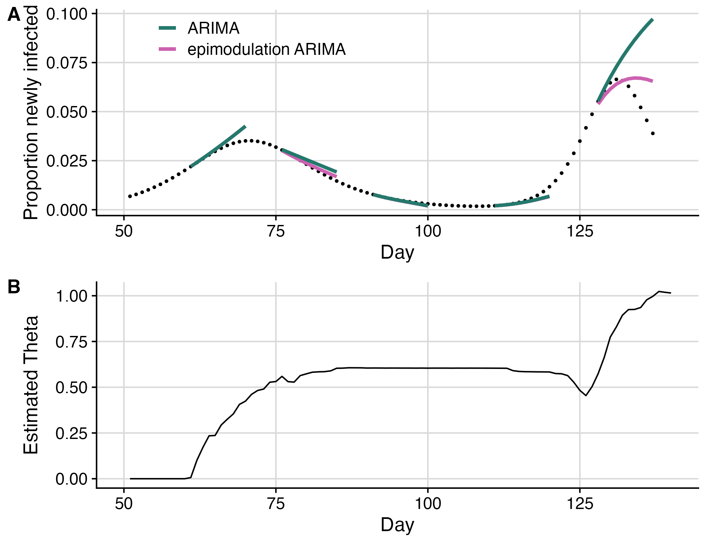
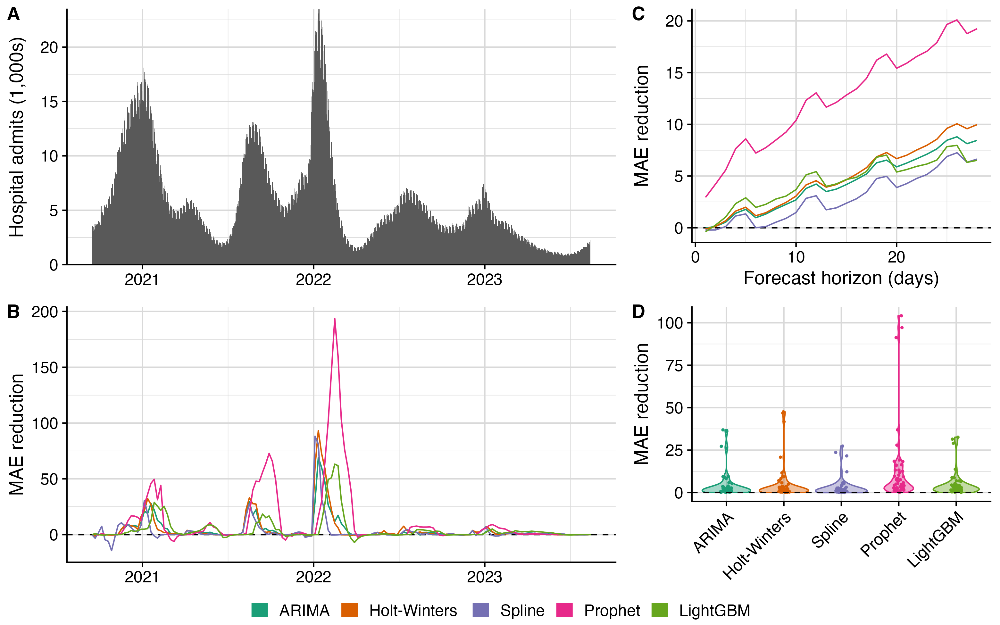
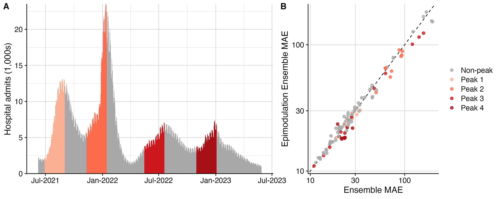

The Fox Lab's latest forecasting work was published in *Proceedings of the National Academy of Sciences*: [Improving outbreak forecasts through model augmentation](https://www.pnas.org/doi/10.1073/pnas.2508575122).

{fig-alt="PNAS article titled Improving outbreak forecasts through model augmentation, published October 24, 2025." loading="lazy" decoding="async"}

This project began during the COVID-19 pandemic, when collaborators noticed that many forecasting models tended to overshoot epidemic peaks. The team wanted a way to correct that behavior without replacing the underlying empirical forecast models.

The solution is called **epimodulation**. The basic idea is to add epidemiological dynamics to a forecast after it has been generated, allowing the method to enforce a peak in a way that better matches outbreak dynamics. A single parameter controls the adjustment, and the method estimates that parameter using historical forecast performance.

{fig-alt="An ARIMA forecast and its epimodulated version agree near the first peak. Before a later peak, a learned theta adjustment makes the epimodulated forecast turn sooner." loading="lazy" decoding="async"}

The team tested the method across multiple models and multiple years of COVID-19 and influenza forecasting. Epimodulation reduced mean absolute error for almost every forecast date, horizon, location, and model tested, with the largest gains during epidemic peaks.

{fig-alt="COVID-19 hospital admissions and forecast error reductions with epimodulation, compared over time, forecast horizons, locations, and five forecasting models." loading="lazy" decoding="async"}

The method also improved the COVID-19 ensemble forecast, a strong benchmark in collaborative outbreak forecasting. Even a 5-10% improvement in a high-performing ensemble can matter when forecasts are used to guide public health planning.

{fig-alt="COVID-19 hospital admissions with epidemic peaks highlighted, and a comparison of ensemble mean absolute errors. Most peak forecasts have lower errors after epimodulation." loading="lazy" decoding="async"}

We are excited to explore how this idea can be used in real-time forecasting systems and extended to other kinds of model biases.

Read the paper: [PNAS](https://www.pnas.org/doi/10.1073/pnas.2508575122)  
Read the preprint: [arXiv](https://arxiv.org/abs/2506.16410)

{fig-alt="Writing retreat in New Mexico." loading="lazy" decoding="async"}

{fig-alt="Nefertiti at a writing retreat." loading="lazy" decoding="async"}
