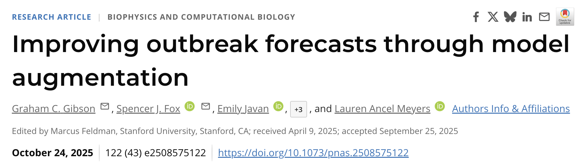
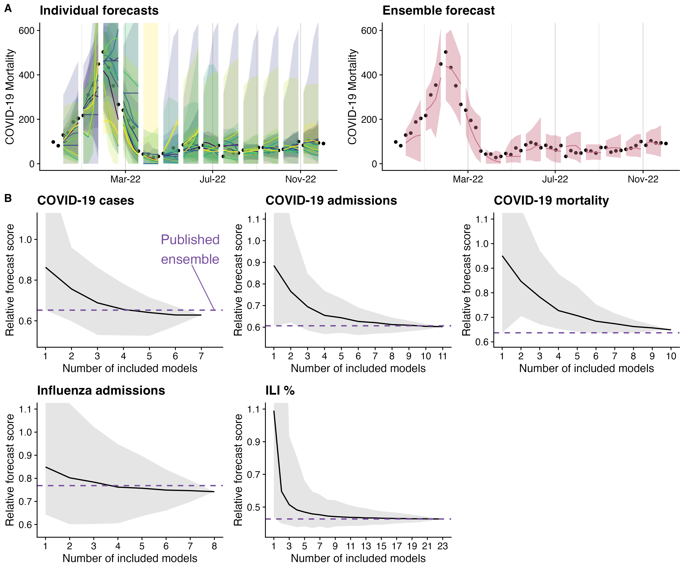

::: {.hero}
::: {.hero-copy}
# The Fox Lab

::: {.affiliation}
Northern Arizona University · Flagstaff, Arizona
:::

::: {.dek}
We build models and forecasts to support public health outbreak responses.
:::

::: {.button-row}
[Research](research.qmd)
[Our thoughts](blog/index.qmd)
[Who we are](people.qmd)
[Join the team](opportunities.qmd)
:::
:::
:::

::: {.photo-slot .photo-slot-wide}
{fig-alt="Photo placeholder for lab group photo." loading="lazy" decoding="async"}

::: {.photo-slot-caption}
**Lab group photo**\
Suggested photo: The team together outdoors, at NAU, or during a lab gathering.
:::
:::

## What We Work On

We are interested in the whole forecasting pipeline: the biology of transmission, the statistics of uncertainty, the software that makes models reproducible, and the human decisions that forecasts are meant to support.

::: {.feature-grid}
::: {.feature}
### Outbreak Forecasting
Predicting respiratory virus activity, healthcare burden, and epidemic trajectories across local, national, and international settings.
:::

::: {.feature}
### Risk Estimation
Estimating transmission risks before, during, and after outbreaks so public health partners can compare what is plausible, what is changing, and what deserves attention.
:::

::: {.feature}
### Model Development
Building statistical, machine learning, and epidemiological models that are useful, transparent, and ready to be stress-tested against real data.
:::
:::

## Join Us

We are building a lab for people who want their quantitative work to matter in the wonderfully complicated world of public health. Students and postdocs work on questions where methods, data, and implementation all matter: How do we forecast respiratory virus burden? How do we make ensembles more reliable? How do we communicate uncertainty to partners who need to act?

::: {.feature-grid}
::: {.feature}
### Prospective PhD Students
Come learn how to turn a scientific question into a model, a model into a forecast, and a forecast into something another human can understand.

[Explore doctoral opportunities](opportunities.qmd)
:::

::: {.feature}
### Postdocs
Lead collaborative forecasting projects, develop new methods, mentor junior scientists, and build a research portfolio with enough room for your own scientific obsessions.

[See postdoc opportunities](opportunities.qmd)
:::

::: {.feature}
### Collaborators
We work with public health agencies, computational researchers, epidemiologists, and domain experts who want models that survive contact with real decisions.

[Get in touch](contact.qmd)
:::
:::

## Recent Highlights

::: {.post-grid}
::: {.post-card}
{fig-alt="PNAS article titled Improving outbreak forecasts through model augmentation, published October 24, 2025." loading="lazy" decoding="async"}

### Improving Outbreak Forecasts
Our PNAS paper introduced epimodulation, a way to augment empirical forecasts with epidemiological dynamics.

[Read the post](blog/2025-11-12-epimodulation/)
:::

::: {.post-card}
{fig-alt="Flagstaff photo" loading="lazy" decoding="async"}

### The Lab Moved To NAU
The Fox Lab is now based in Flagstaff, Arizona, where we are building the next phase of our forecasting work.

[Read the post](blog/2025-10-23-nau-move/)
:::

::: {.post-card}
{fig-alt="Individual and ensemble outbreak forecasts, followed by relative forecast scores for five forecast targets. Average scores and their variability decrease as more models enter an ensemble, with diminishing gains." loading="lazy" decoding="async"}

### Forecast Ensemble Design
Our Emerging Infectious Diseases paper studied how ensemble size affects outbreak forecast performance.

[Read the post](blog/2024-10-28-ensemble-size/)
:::
:::
