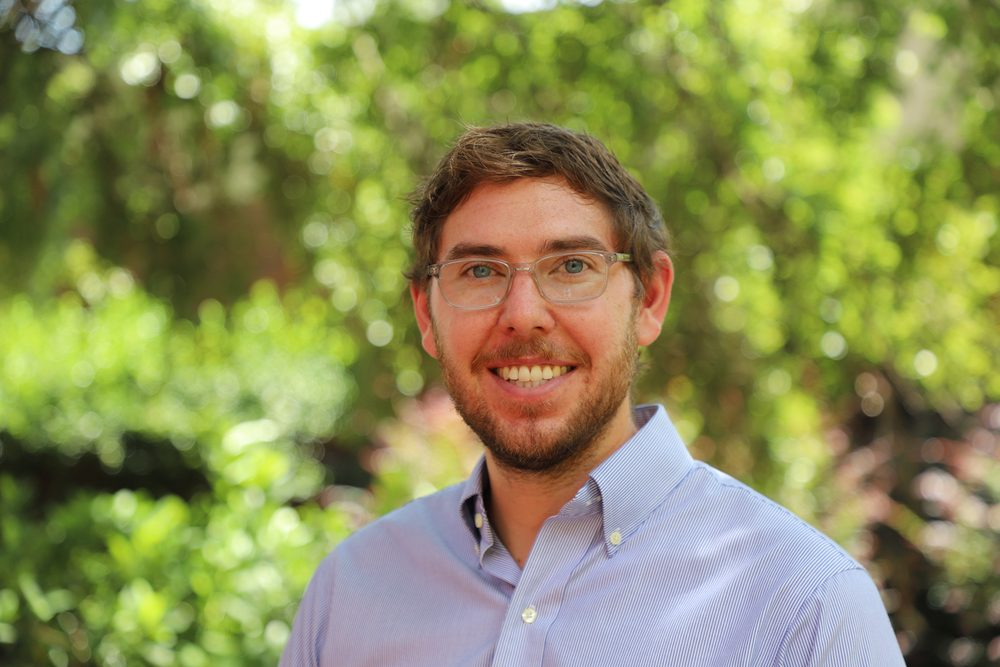
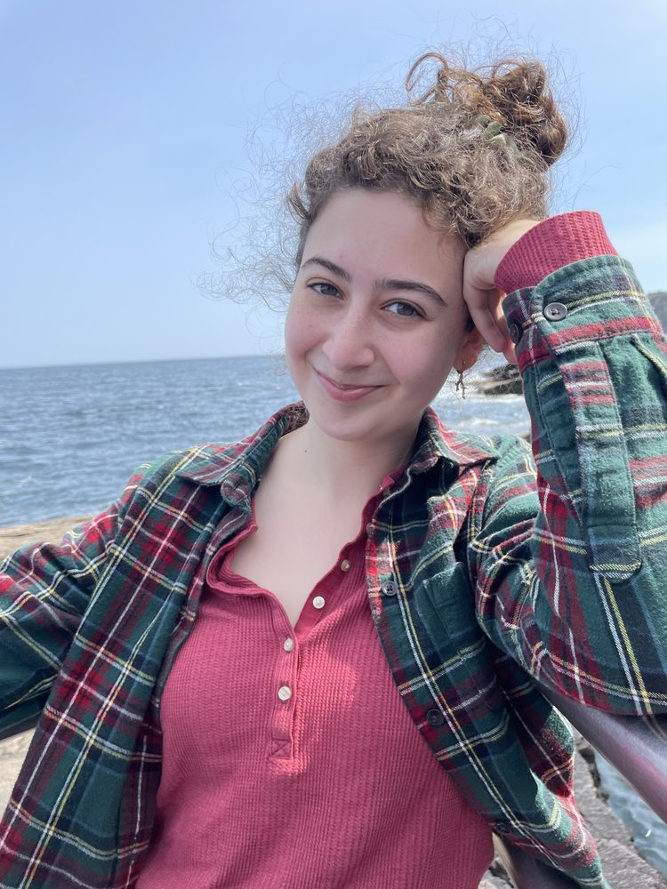
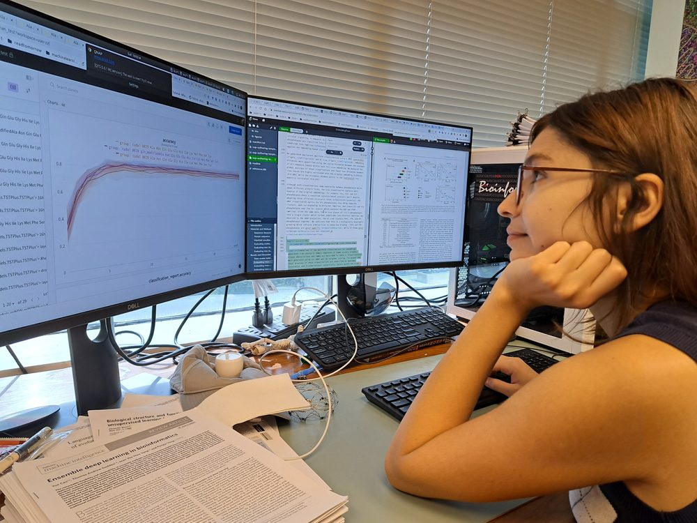
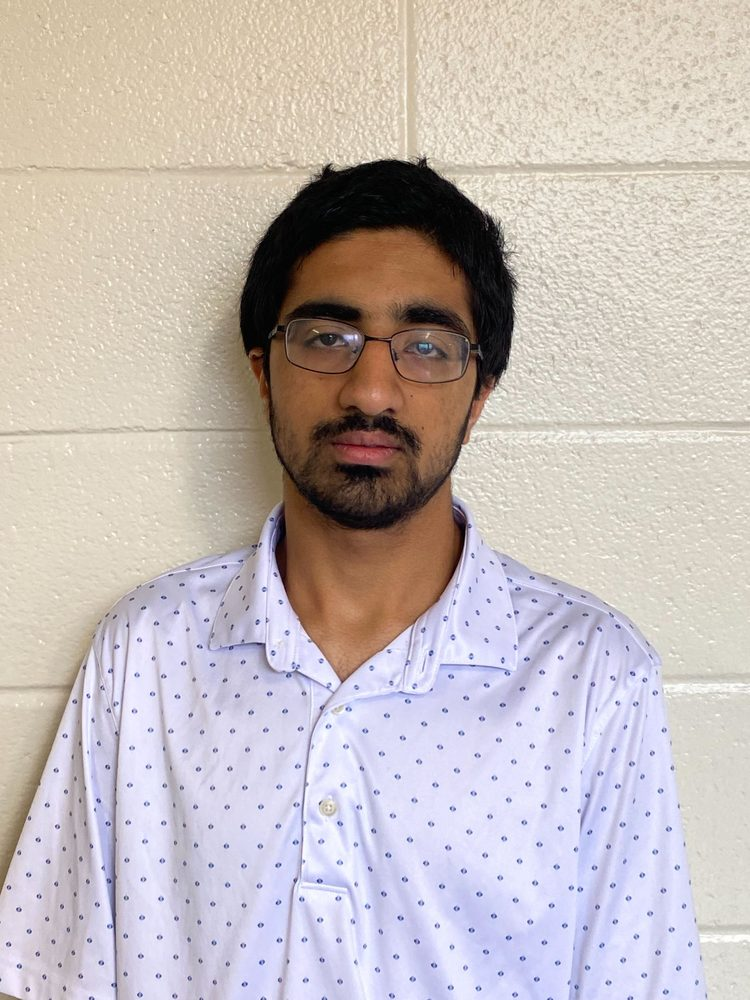

The Fox Lab is a small, collaborative group of modelers, data scientists, epidemiologists, and public health thinkers. This page is intentionally easy to edit as the lab grows.

::: {.people-grid}
::: {.person}
{fig-alt="Dr. Spencer J. Fox" loading="lazy" decoding="async"}

### [Dr. Spencer J. Fox](people/spencer-fox/index.qmd)
Principal investigator · Assistant Professor  
School of Informatics, Computing, and Cyber Systems  
Northern Arizona University  
spencer.fox@nau.edu  
[View profile](people/spencer-fox/index.qmd)
:::

::: {.person}
{fig-alt="Bren Case" loading="lazy" decoding="async"}

### Bren Case
Postdoctoral Associate, Epidemiology & Biostatistics  
bcase@uga.edu
:::

::: {.person}
{fig-alt="Annalise Cramer" loading="lazy" decoding="async"}

### Annalise Cramer
PhD student, Epidemiology & Biostatistics  
Annalise.Cramer1@uga.edu
:::

::: {.person}
{fig-alt="Maya Salcedo" loading="lazy" decoding="async"}

### Maya Salcedo
PhD student, Institute of Bioinformatics  
Mariah.Salcedo@uga.edu
:::

::: {.person}
{fig-alt="New lab members" loading="lazy" decoding="async"}

### New Lab Members
Possibly you. We are especially excited to meet people who like data, disease dynamics, careful thinking, and projects that matter outside the lab.

[Explore opportunities](opportunities.qmd)
:::
:::

## Past Members

::: {.people-grid}
::: {.person}
{fig-alt="Ehsan Suez" loading="lazy" decoding="async"}

### Ehsan Suez
PhD alumnus, Institute of Bioinformatics  
After graduation: [CDC Steven M. Teutsch Prevention Effectiveness Fellowship](https://www.cdc.gov/pef/php/about/index.html)
:::

::: {.person}
{fig-alt="Rajath Prabhakar" loading="lazy" decoding="async"}

### Rajath Prabhakar
Undergraduate Student, Statistics  
After the lab: MPH student at Emory University
:::
:::
